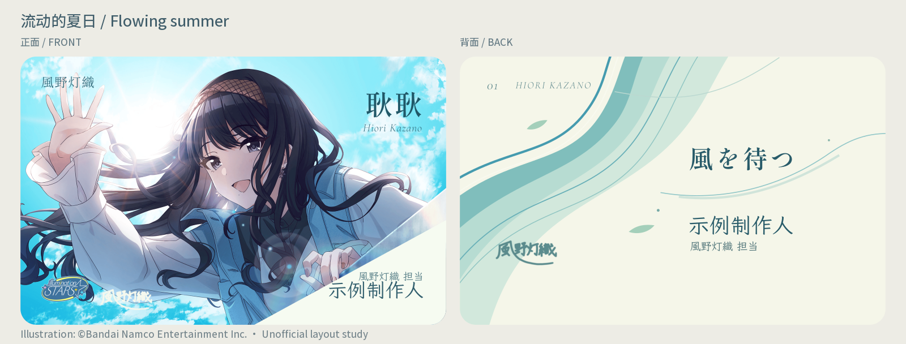
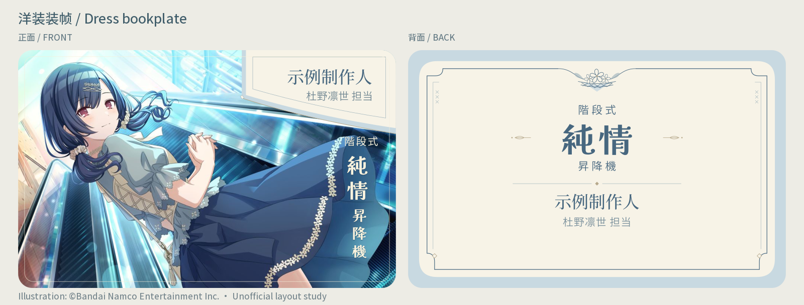

# Shiny Colors Producer Card Design

**闪耀色彩小偶像担当名片公式化设计**

[简体中文](README.md) · [Skill](skills/shiny-colors-meishi-design/SKILL.md) · [Examples](examples/README.en.md)

An installable Agent Skill for designing and revising producer exchange cards for **THE IDOLM@STER SHINY COLORS**. It covers character research, artwork selection, front-and-back composition, typography, personal information, and export checks.

The package includes bilingual instructions, two anonymous example pairs, four editable SVG templates, and an optional SVG inspection and text-outlining tool. It is intended for character-focused fan exchange cards and revisions to them.

**“Formulaic” refers to a repeatable workflow.** Each character and selected artwork should determine the palette, motifs, typography, and composition.

## Capabilities and workflow

| Stage | Agent's work | User's input |
| --- | --- | --- |
| Define the project | Review the intended use, existing decisions, feedback, and delivery requirements | Character, intended use, known specifications |
| Research and select | Inspect artwork and prepare numbered candidates with source records | Artwork selection and number of cards |
| Create a sample | Design one front-and-back pair around the artwork's pose, environment, clothing, color, and available space | Direction and feedback |
| Revise and expand | Improve composition, typography, and spacing; extend the approved approach while giving each card its own visual character | Feedback and any changes to the scope |
| Apply information | Add only supplied and requested fields; remove empty fields, labels, and placeholders, then rebalance the layout | Details to display |
| Export and inspect | Deliver editable sources, previews, agreed exports, and source notes; identify completed checks and remaining printer requirements | Final output requirements |

Existing selections and approvals carry forward. Work can start from an existing design, and a full set can proceed when already authorized.

The agent can find and download publicly accessible artwork or use supplied images. It records the **official reference page** separately from the **actual download source**, including community mirrors. The front integrates the character, setting, title, and producer identity. The back defaults to typography and vector graphics; AI illustration requires an explicit request.

The skill supplies guidance and supporting files. Research, editing, and rendering depend on the capabilities of the agent running it.

## Examples

### Flowing summer · Hiori Kazano



The sky, pose, and flowing lines give the front its direction. The angled name area follows that movement; the back carries the color and rhythm into a composition of its own.

### Dress bookplate · Rinze Morino



This pair takes its blue and cream palette, fine borders, and small floral accents from the outfit and scene. The spacing and proportions give the name, title, and decorative details their places on the card.

Both previews use **示例制作人** (“Sample Producer”) and have no contact details. The previews include third-party character artwork. The four editable SVGs use original graphics and image-placement guides, with no official artwork, signatures, or unit-logo assets bundled. Sources, font suggestions, and replacement notes are in the [example guide](examples/README.en.md) and [third-party notices](THIRD_PARTY_NOTICES.md).

## Installation

In Codex, ask an agent with GitHub skill installation support:

```text
Use $skill-installer to install:
https://github.com/crackthedream/shiny-colors-meishi-design/tree/main/skills/shiny-colors-meishi-design
```

You can also download the repository and copy the complete `skills/shiny-colors-meishi-design` folder into `~/.codex/skills/`, or the `skills/` subdirectory of your configured `CODEX_HOME`. Keep that folder intact so its references, templates, and tools remain available. Invoke it in the next conversation turn.

Other agents that support `SKILL.md` can load the same folder through their own installation method. Tool availability varies by client; there is no dependency on a particular browser plugin or fixed local path.

## Usage

For a new project:

```text
$shiny-colors-meishi-design
I want long-term producer exchange cards for Rinze Morino.
Research the character and show me numbered artwork candidates first.
Let me choose before you design. Use official artwork on the front
and typography with vector graphics on the back. Start with one front/back pair.
Leave personal information out for now.
```

Or bring an existing design:

```text
$shiny-colors-meishi-design
Check whether the character, title, and producer name work together.
Keep the agreed visual direction, but improve the type and spacing.
Remove any contact fields I haven't filled in.
```

## Resources

| If you want to… | Open… |
| --- | --- |
| Read the skill's instructions | [SKILL.md](skills/shiny-colors-meishi-design/SKILL.md) |
| Follow the full process | [English workflow](skills/shiny-colors-meishi-design/references/design-workflow.en.md) / [中文流程](skills/shiny-colors-meishi-design/references/design-workflow.zh-CN.md) |
| Edit one of the four SVG starting points | [Templates](skills/shiny-colors-meishi-design/assets/templates) |
| Check an SVG or outline its text | [Tool guide](skills/shiny-colors-meishi-design/references/svg-tools.md) |
| Look up example sources and fonts | [English notes](examples/README.en.md) / [中文说明](examples/README.zh-CN.md) |

## Export checks and printing limits

The examples use a finished size of **85.60 × 53.98 mm**. For an actual order, confirm the size, corner radius, safe area, bleed, and export requirements with your printer. These are editable design examples; printer-specific preparation and a visual check of every face are still needed. A high DPI setting cannot add detail missing from the source image.

The optional Python tool checks SVG dimensions, font coverage, and safe margins for supported text, and can convert that text to outlines. It does not assess the design's appearance or certify a file for print. After outlining, render the result and compare the text, positions, cropping, and images with the source.

<details>
<summary>Running the optional SVG tool</summary>

The design process works without these scripts. To use the tool:

```bash
python -m pip install -r skills/shiny-colors-meishi-design/requirements.txt
python skills/shiny-colors-meishi-design/scripts/svg_text_tools.py --help
```

It supports a documented subset of SVG text, reports unsupported structures, and uses fonts you supply. See the [tool guide](skills/shiny-colors-meishi-design/references/svg-tools.md) for commands and limits.

For maintenance, run `python tests/test_svg_text_tools.py` from the repository root. The tests cover dimensions, missing glyphs, margins, image preservation during outlining, and rejection of unsupported structures. They create temporary test glyphs and need no font downloads.

</details>

## License and privacy

The original instructions, scripts, and layouts without official artwork are available under the [MIT License](LICENSE). Third-party character images, game names, and trademarks remain outside that license; see [THIRD_PARTY_NOTICES.md](THIRD_PARTY_NOTICES.md). This is an unofficial project with no affiliation to the rights holders.

The public package leaves out participants' real names, contact details, original conversations, personal directories, font binaries, and the complete artwork collection. Personal information you add belongs to your own card project. Please remove it before sharing files or contributing changes here.

## A final note

This is a byproduct of trying to make some producer cards with Codex. I wouldn’t claim the results are especially beautiful or sophisticated, but I think they’re decent enough, and I hope they can be of some help to fellow Producers. Of course, if you’ve got a good eye for design, you can always make your own from scratch.

If you run into any issues, feel free to get in touch. You’re also welcome to tweak things yourself—there’s nothing particularly technical here. And who knows, a bigger, stronger Claude model might make something better-looking.
